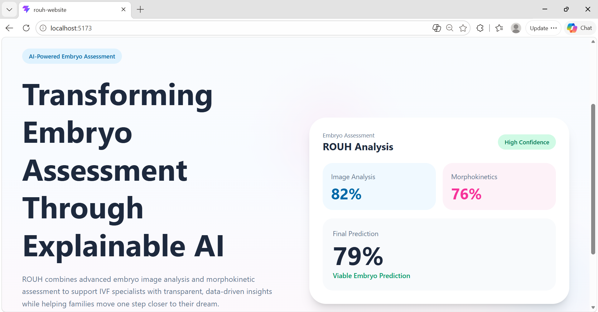
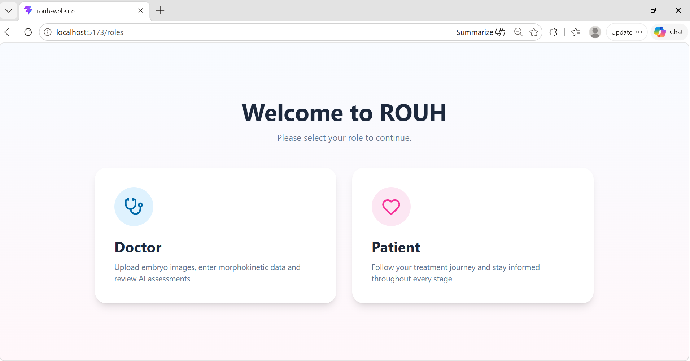
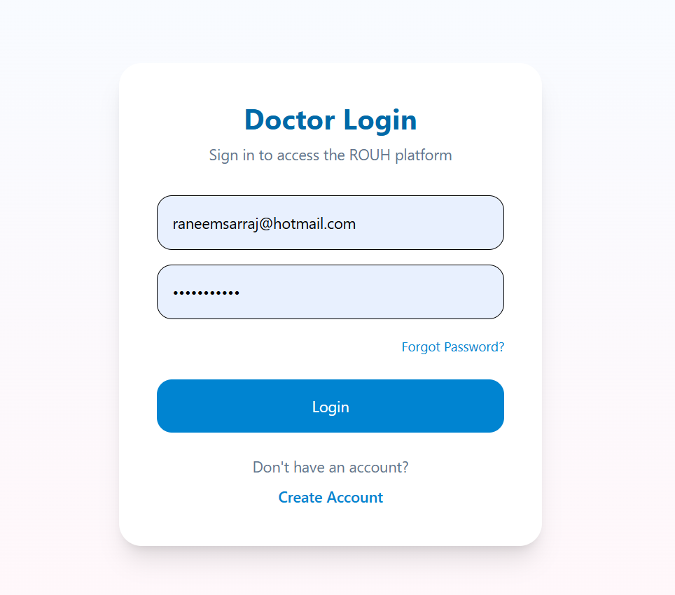
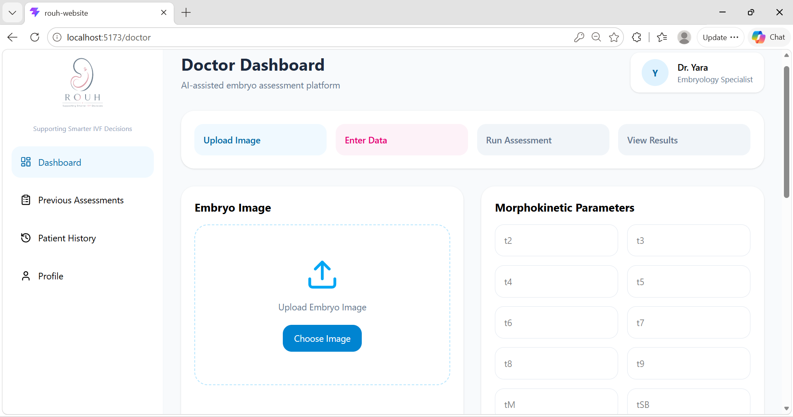
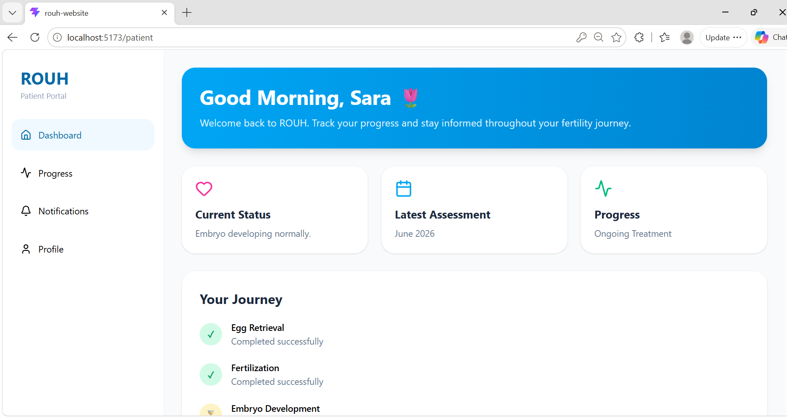

# ROUH — AI-Based Embryo Viability Assessment

**A research prototype exploring non-invasive embryo viability assessment using image classification, morphokinetic analysis, and weighted late fusion.**

ROUH was developed as a graduation project at Middle East University. It investigates how two separate AI models can support embryo assessment: an image model that examines embryo imagery and a morphokinetic model that uses developmental timing features. Their predicted probabilities are combined at the **decision level (late fusion)**.

> **Research and demonstration only.** ROUH is not a clinically validated diagnostic tool and should not be used for medical decisions.

## Project at a glance

| Component | Approach |
| --- | --- |
| Image analysis | CNN baseline, ResNet50, EfficientNetB0 |
| Morphokinetic analysis | LSTM, with GRU comparison |
| Late fusion | Weighted combination of output probabilities |
| Explainability | Grad-CAM for image analysis; SHAP for feature insights |
| Interface | Local React/Vite website prototype |

## How late fusion works

The image and morphokinetic models process their respective inputs separately. The demonstration combines their output probabilities using the following weighting:

```text
Final viability probability =
    0.60 × image-model probability
  + 0.40 × morphokinetic-model probability
```

**Important limitation:** The source datasets did not provide paired image and morphokinetic records for the same embryos. Consequently, the fusion examples illustrate the *method*, rather than providing a clinically validated or independently measured end-to-end fusion accuracy.

## Repository contents

| File | Description |
| --- | --- |
| [`image_classification_clean.ipynb`](image_classification_clean.ipynb) | Image-model experiments, evaluation, and Grad-CAM |
| [`morphokinetic_lstm_late_fusion.ipynb`](morphokinetic_lstm_late_fusion.ipynb) | Morphokinetic models, evaluation, SHAP, and late-fusion demonstration |
| [`MORPHOKINETIC_README.md`](MORPHOKINETIC_README.md) | Notes on the morphokinetic notebook and its limitations |
| [`Yara El Sarraj - Poster 2.pdf`](Yara%20El%20Sarraj%20-%20Poster%202.pdf) | Graduation project poster |
| `*.png` | Screenshots of the local web application prototype |

## Recorded model experiments

The notebooks include comparisons of classical and transfer-learning-based image approaches, as well as LSTM and GRU for morphokinetic data.

Some results recorded during development include:

| Experiment | Recorded test accuracy |
| --- | ---: |
| Image — EfficientNetB0 | 88.10% |
| Morphokinetic — LSTM | 85.11% |

These are **individual model experiment results**, **not** accuracy of the combined late-fusion system. Results depend on the notebook versions, data splits, and preprocessing used. The morphokinetic notebook fits a scaler before the train/test split; this introduces potential data leakage, so its reported metrics should be treated as preliminary until the experiment is rerun with training-only preprocessing.

## Web application prototype

A local React-based interface was designed to demonstrate user roles and the embryo assessment workflow. **It is not currently presented here as a deployed or fully integrated production application.** The images below are interface screenshots, not evidence of clinical validation.

### Landing page


### Role selection and authentication



### Doctor and patient dashboards



### Assessment workflow and explainability


*Screenshots may contain illustrative assessment values rather than independently verified end-to-end predictions.*

## Project poster

[**View the ROUH graduation poster (PDF)**](Yara%20El%20Sarraj%20-%20Poster%202.pdf)

The poster's **87% final prediction** is presented as an example assessment output, **not** as a validated overall model accuracy figure.

## Technologies

Python · TensorFlow/Keras · scikit-learn · Computer Vision · LSTM · Grad-CAM · SHAP · React · Vite

## Limitations and future work

- Limited data and class imbalance may affect generalization.
- Image and morphokinetic datasets are **not paired embryo-by-embryo**, preventing a reliable evaluation of combined late-fusion performance.
- The morphokinetic preprocessing pipeline requires retraining after the scaler is fitted exclusively on training data.
- Broader external evaluation and clinical validation would be required before considering any real-world use.
- The website is a **local prototype**; its source code and a working hosted demo are not included in this repository.

## Author

**Yara El Sarraj** — Artificial Intelligence Graduate, Middle East University

---
*ROUH is an academic research prototype intended to demonstrate machine learning engineering, evaluation, explainability, and interface design.*
